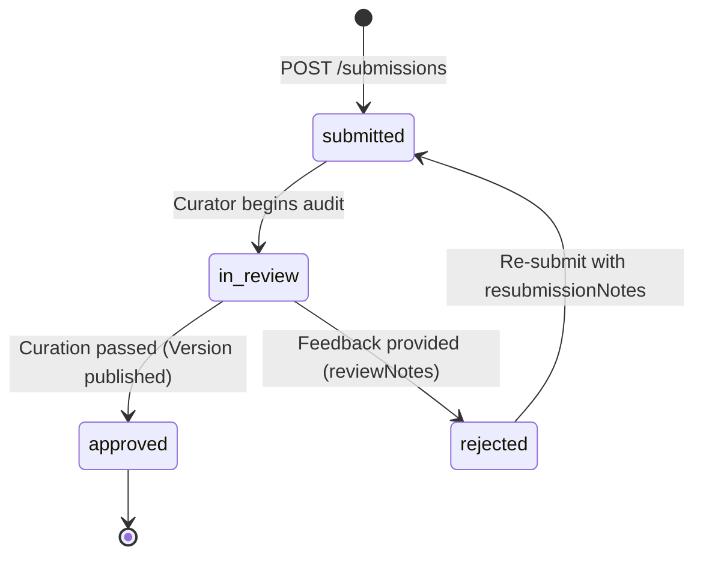

# Submissions & Security Manifests

Node.aec operates a curated BIM software ecosystem. Before any plugin or product version can be published and made downloadable to customers, it must pass a formal curation review with a validated **Security Manifest**.

---

## 1. The 6-Capability Security Manifest Contract

Every version submission requires a declared Security Manifest. This contract communicates to administrators and enterprise customers exactly what system capabilities your plugin requests.

The manifest is an object composed of **6 capability sections**:

```json
{
  "network": {
    "hasAccess": true,
    "purpose": "License verification and analytics logging",
    "domains": ["api.mycompany.com", "licensing.nodeaec.com.br"]
  },
  "filesystem": {
    "hasAccess": true,
    "scope": "Reads user-selected Revit .rvt models; writes exported IFC and BCF report files to designated output directories."
  },
  "processes": {
    "hasAccess": false,
    "justification": ""
  },
  "nativeCalls": {
    "hasAccess": true,
    "libraries": ["kernel32.dll", "user32.dll"]
  },
  "registry": {
    "hasAccess": true,
    "keys": [
      "HKEY_CURRENT_USER\\Software\\MyCompany\\SmartClashDetector"
    ]
  },
  "telemetry": {
    "hasAccess": true,
    "fields": ["app_version", "revit_version", "execution_time_ms", "os_build"],
    "purpose": "Anonymous diagnostic crash metrics and feature adoption statistics."
  }
}
```

### Capability Definitions

| Capability | Property | Type | Description / Limits |
| :--- | :--- | :--- | :--- |
| **`network`** | `hasAccess`<br>`purpose`<br>`domains` | boolean<br>string<br>string[] | Declares outbound internet or intranet connectivity.<br>Max purpose length: 2,000 chars.<br>Max 50 domains, max 255 chars per domain. |
| **`filesystem`** | `hasAccess`<br>`scope` | boolean<br>string | Declares local filesystem read/write access.<br>Max scope text length: 2,000 chars. |
| **`processes`** | `hasAccess`<br>`justification` | boolean<br>string | Declares spawning or communicating with child subprocesses (e.g. `cmd.exe`, external CLI binaries).<br>Max justification length: 2,000 chars. |
| **`nativeCalls`** | `hasAccess`<br>`libraries` | boolean<br>string[] | Declares unmanaged P/Invoke, C/C++ native DLLs, or Windows API calls.<br>Max 50 libraries, max 255 chars per library. |
| **`registry`** | `hasAccess`<br>`keys` | boolean<br>string[] | Declares Windows Registry read/write keys (e.g. installation paths, licensing tokens).<br>Max 50 keys, max 255 chars per key. |
| **`telemetry`** | `hasAccess`<br>`fields`<br>`purpose` | boolean<br>string[]<br>string | Declares collection of telemetry, analytics, or error reporting.<br>Max 50 fields, max 100 chars per field.<br>Max purpose text length: 2,000 chars. |

> **Manifest Validation**: All keys in the manifest are validated server-side. Setting `hasAccess: true` without required justifications, or passing strings exceeding character limits, returns `400 INVALID_SECURITY_MANIFEST`.

---

## 2. Inspect Baseline Manifest (`/manifest`)

Before submitting, you can fetch the baseline security manifest for a version. This endpoint returns the manifest from:
- `live`: The currently approved manifest of a published version.
- `pending`: An active revision change awaiting curator review.
- `draft`: The latest submitted draft manifest.
- `default`: The default zero-privilege security manifest.

```http
GET /developer/products/:idOrSlug/versions/:versionOrPublicId/manifest HTTP/1.1
Host: api.nodeaec.com.br
Authorization: Bearer aec_...
```

### Example cURL

```bash
curl -s -X GET "https://api.nodeaec.com.br/developer/products/smart-clash-detector/versions/1.3.0/manifest" \
  -H "Authorization: Bearer $NODE_AEC_API_TOKEN"
```

### Response `200 OK`

```json
{
  "securityManifest": {
    "network": { "hasAccess": false, "purpose": "", "domains": [] },
    "filesystem": { "hasAccess": false, "scope": "" },
    "processes": { "hasAccess": false, "justification": "" },
    "nativeCalls": { "hasAccess": false, "libraries": [] },
    "registry": { "hasAccess": false, "keys": [] },
    "telemetry": { "hasAccess": false, "fields": [], "purpose": "" }
  },
  "source": "default"
}
```

---

## 3. Submit Version for Curation Review

Submits an unreleased draft version (along with its uploaded release binaries) for curation review.

### Prerequisites for Submission
1. Product must have a title, slug, category, and description.
2. At least one gallery image must be uploaded.
3. At least one release file (`files/upload`) must be present in the version.
4. If a previous submission was rejected, `resubmissionNotes` is **required**.

```http
POST /developer/products/:idOrSlug/versions/:versionOrPublicId/submissions HTTP/1.1
Host: api.nodeaec.com.br
Authorization: Bearer aec_...
Content-Type: application/json

{
  "securityManifest": {
    "network": {
      "hasAccess": true,
      "purpose": "Cloud license verification",
      "domains": ["auth.mycompany.com"]
    },
    "filesystem": {
      "hasAccess": true,
      "scope": "Reads current Revit model documents"
    },
    "processes": { "hasAccess": false, "justification": "" },
    "nativeCalls": { "hasAccess": false, "libraries": [] },
    "registry": { "hasAccess": false, "keys": [] },
    "telemetry": { "hasAccess": false, "fields": [], "purpose": "" }
  },
  "resubmissionNotes": "Resolved Revit 2026 crash on startup and tightened file permissions."
}
```

### Example cURL

```bash
curl -X POST "https://api.nodeaec.com.br/developer/products/smart-clash-detector/versions/1.3.0/submissions" \
  -H "Authorization: Bearer $NODE_AEC_API_TOKEN" \
  -H "Content-Type: application/json" \
  -d '{
    "securityManifest": {
      "network": { "hasAccess": false, "purpose": "", "domains": [] },
      "filesystem": { "hasAccess": true, "scope": "Reads active BIM project and saves report." },
      "processes": { "hasAccess": false, "justification": "" },
      "nativeCalls": { "hasAccess": false, "libraries": [] },
      "registry": { "hasAccess": false, "keys": [] },
      "telemetry": { "hasAccess": false, "fields": [], "purpose": "" }
    }
  }'
```

### Response `201 Created`

```json
{
  "submission": {
    "publicId": "6v7b8n9m0k1l2p",
    "productPublicId": "1a2b3c4d5e6f7g",
    "productVersionPublicId": "9z8y7x6w5v4u3t",
    "kind": "new_version",
    "status": "submitted",
    "securityManifest": { ... },
    "resubmissionNotes": null,
    "createdAt": "2026-10-20T03:30:00.000Z"
  }
}
```

---

## 4. Submitting Review for a Complete Product (`submit-review`)

Alternatively, `POST /developer/products/:idOrSlug/submit-review` can be used to automatically find the eligible draft version and validate all product prerequisites in a single call:

```bash
curl -X POST "https://api.nodeaec.com.br/developer/products/smart-clash-detector/submit-review" \
  -H "Authorization: Bearer $NODE_AEC_API_TOKEN" \
  -H "Content-Type: application/json" \
  -d '{
    "securityManifest": {
      "network": { "hasAccess": false, "purpose": "", "domains": [] },
      "filesystem": { "hasAccess": true, "scope": "Saves clash matrix reports." },
      "processes": { "hasAccess": false, "justification": "" },
      "nativeCalls": { "hasAccess": false, "libraries": [] },
      "registry": { "hasAccess": false, "keys": [] },
      "telemetry": { "hasAccess": false, "fields": [], "purpose": "" }
    }
  }'
```

---

## 5. Query Submission Status

Track the review progress of your submissions across all products or for a specific product.

### Across All Products

```http
GET /developer/products/submissions?product=smart-clash-detector&status=submitted HTTP/1.1
Host: api.nodeaec.com.br
Authorization: Bearer aec_...
```

### Query Parameters

| Parameter | Type | Required | Description |
| :--- | :--- | :--- | :--- |
| `product` | string | No | Filter by product `slug` or Base62 `publicId`. |
| `status` | string | No | Filter by status: `submitted`, `in_review`, `approved`, `rejected`. |
| `page` | integer | No | Pagination page (default: `1`). |
| `limit` | integer | No | Items per page (default: `20`). |

### Example cURL

```bash
curl -s -X GET "https://api.nodeaec.com.br/developer/products/submissions?product=smart-clash-detector" \
  -H "Authorization: Bearer $NODE_AEC_API_TOKEN"
```

### Response `200 OK`

```json
{
  "submissions": [
    {
      "publicId": "6v7b8n9m0k1l2p",
      "productPublicId": "1a2b3c4d5e6f7g",
      "productVersionPublicId": "9z8y7x6w5v4u3t",
      "kind": "new_version",
      "status": "in_review",
      "reviewNotes": null,
      "createdAt": "2026-10-20T03:30:00.000Z",
      "updatedAt": "2026-10-20T04:15:00.000Z"
    }
  ],
  "total": 1,
  "page": 1,
  "limit": 20
}
```

### Review Status Lifecycle


